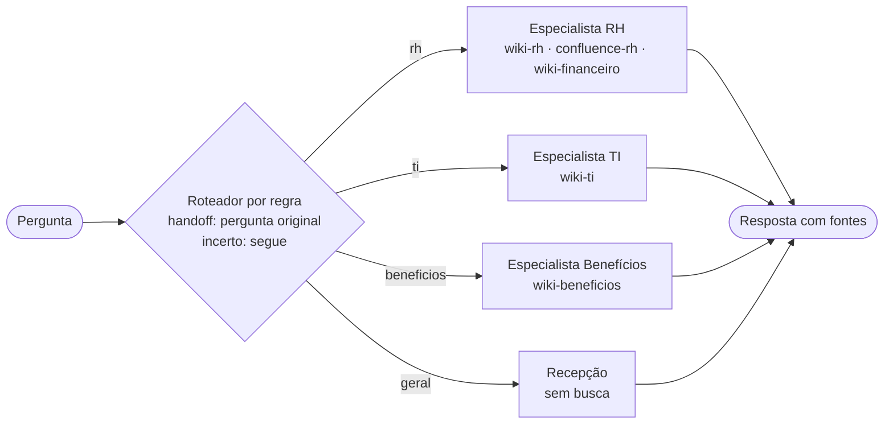

# Nota de arquitetura · Encontro 4

**Equipe:** Raione Nascimento
**Integrantes:** Raione Nascimento

> Uma página. A pergunta é uma só: **a divisão em vários agentes se paga no caso da Aurora?** Decidir **não** dividir, com números, é uma resposta tão válida quanto dividir.

## 1. O padrão escolhido

**Padrão:** roteador + especialistas

**Configuração:** roteador por regra (palavras-chave, sem chamada ao modelo); equipe de 3 (RH absorve o Financeiro; TI; Benefícios; mais a Recepção); handoff da pergunta original; quando o roteador empata ou não acha palavra, a confiança fica baixa e ele segue mesmo assim para o destino com mais pontos.

## 2. O diagrama



## 3. O placar

| arquitetura | acertos | rota certa | chamadas/caso | tokens/caso | custo total (US$) | custo/acerto (US$) | seg/caso |
|---|---|---|---|---|---|---|---|
| agente único (Aula 3) | 16/19 | 17/17 | 2.6 | 3007 | 0.0655 | 0.00409 | 2.7 |
| roteador llm · 3 esp · original · incerto→segue | 16/19 | 14/17 | 3.1 | 2588 | 0.0599 | 0.00375 | 3.2 |
| supervisor · 3 esp | 17/19 | 15/17 | 3.9 | 3370 | 0.079 | 0.00465 | 4.2 |
| roteador regra · 3 esp · original · incerto→segue | 16/19 | 14/17 | 2.0 | 2279 | 0.0506 | 0.00316 | 2.1 |

## 4. A divisão se paga?

Sim, na configuração do roteador por regra com 3 especialistas. Ele acertou 16/19, o mesmo que o agente único, e o custo por acerto caiu de US$ 0,00409 para US$ 0,00316 (cerca de 23% mais barato), com 2,0 chamadas por caso contra 2,6 e 2,1 s contra 2,7 s. A rota certa piorou de 17/17 para 14/17. O limite entre os especialistas é real: cada busca está presa aos espaços da área (RH vê wiki-rh, confluence-rh e wiki-financeiro; TI só wiki-ti; Benefícios só wiki-beneficios; a Recepção não busca), então a divisão atende o controle de acesso por fonte. O supervisor chegou a 17/19, mas o custo por acerto subiu para US$ 0,00465 e o tempo para 4,2 s. Voltamos ao supervisor se perguntas de duas áreas, como o R1, ficarem frequentes o bastante para esse acerto extra pagar o custo.

## 5. Um caso, aberto

**Caso:** R1 — limite diário de alimentação na viagem ao Rio e o que fazer se a VPN não conectar no Wi-Fi do hotel.
**Causa:** pergunta de duas áreas
**A linha do trace que mostra a causa:**

```
[roteador] → rh (confiança alta)  · palavras: ['vpn', 'wi-fi', 'viajar', 'hotel', 'alimentacao']
[especialista rh] acessa: wiki-rh, confluence-rh, wiki-financeiro
```

Viagem, hotel e alimentação somaram 3 pontos e foram para o RH; VPN e Wi-Fi somaram 2 e ficaram com a TI, que nunca foi chamada. O handoff levou a pergunta inteira, então o detalhe da VPN não se perdeu no texto. O RH respondeu os R$ 160 com `fin-viagens-e-reembolso` e não citou `ti-vpn-e-acesso-remoto`, porque a parede impede esse especialista de ver a wiki-ti. O agente único tinha acertado o R1 justamente porque enxerga os dois espaços.

## 6. Para o domínio da equipe (opcional)

O caso continua sendo a Aurora Tecnologia. Esta seção não se aplica.
